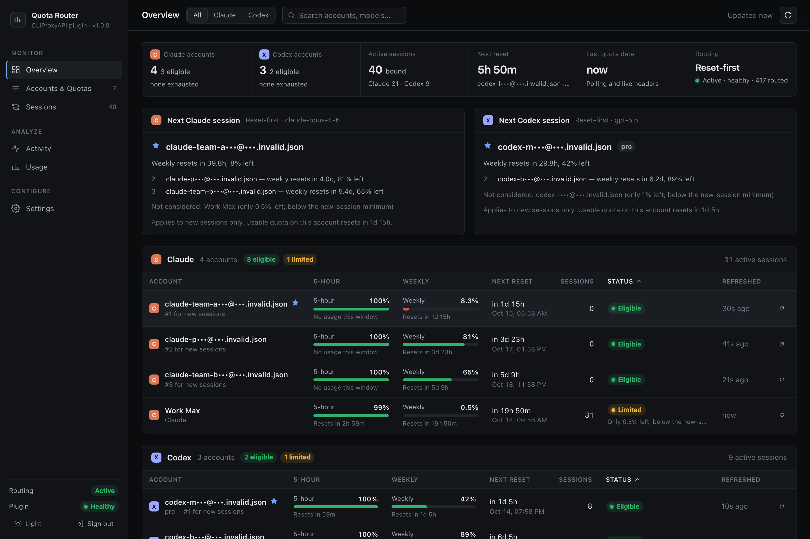
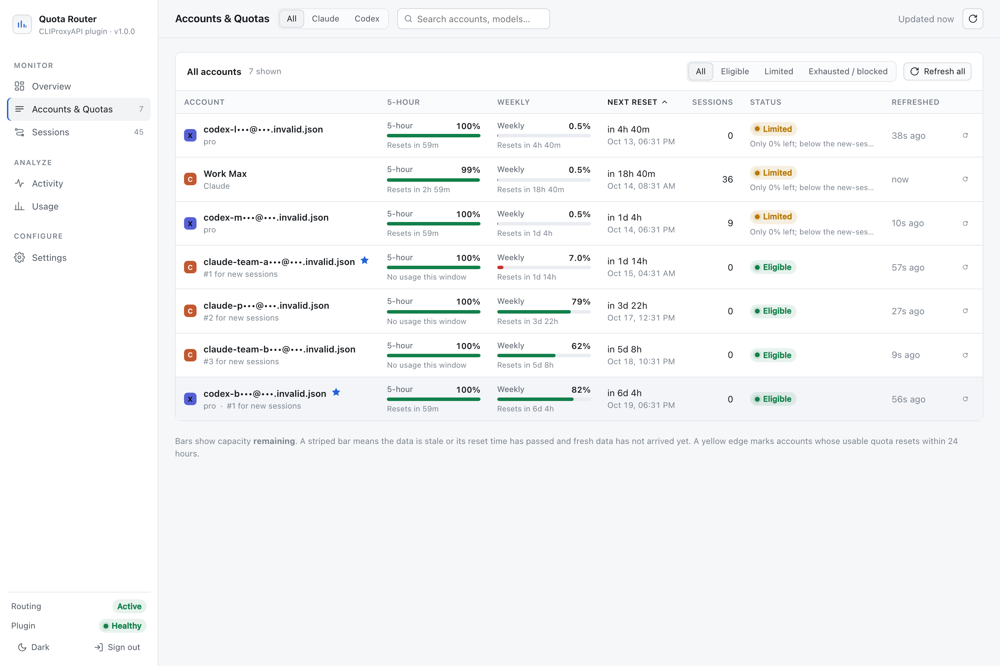
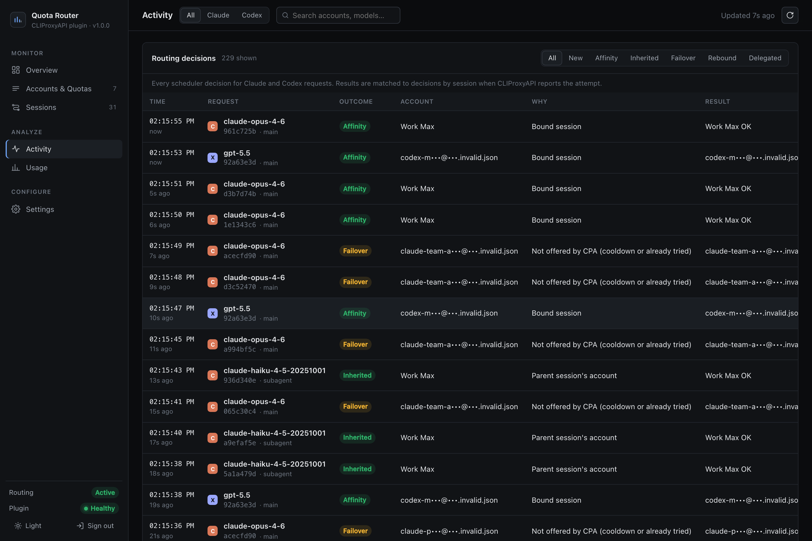
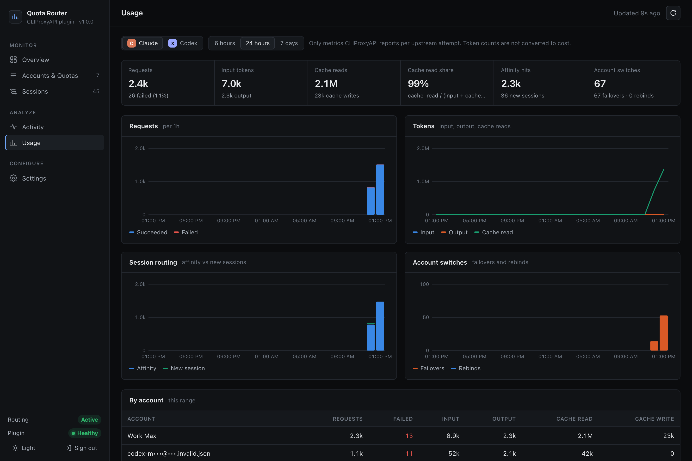
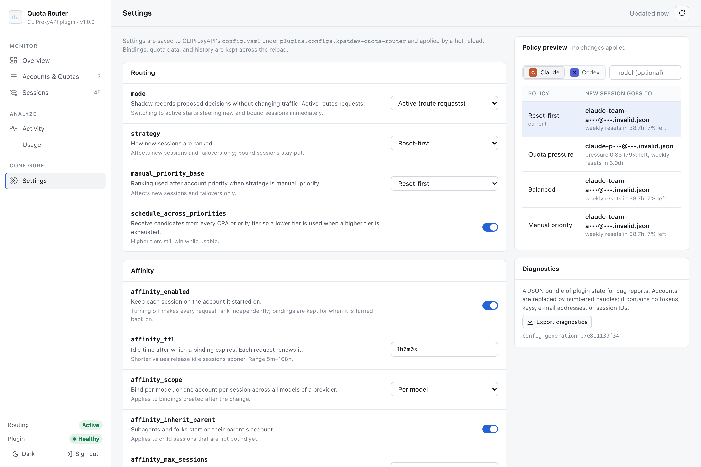
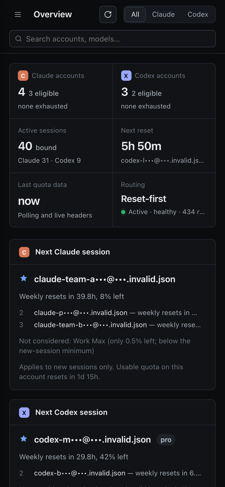
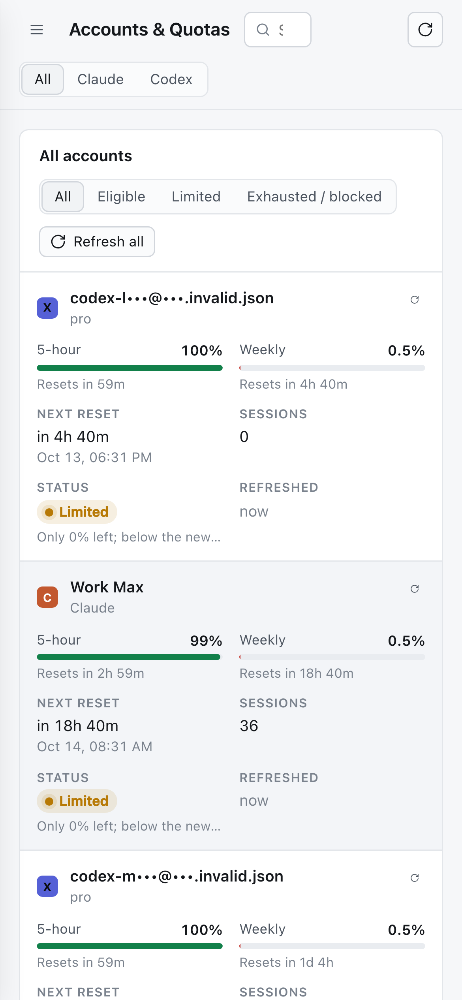
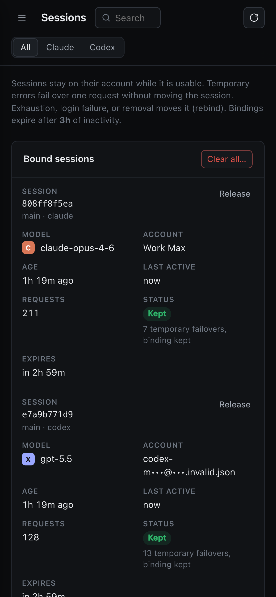

# kpatdev-quota-router

A [CLIProxyAPI](https://github.com/router-for-me/CLIProxyAPI) (CPA) scheduler plugin for Claude and Codex OAuth accounts. It keeps each conversation on one account and sends new conversations to the account whose quota is most at risk of expiring unused. It ships with a built-in dashboard.

- **Quota-aware:** it reads each account's five-hour, weekly, monthly, and per-model (Sonnet/Opus/…) windows. New sessions go to the account whose weekly quota resets soonest, or to another policy you choose.
- **Session-aware:** requests from the same Claude Code or Codex session (and its subagents) stay on the same account, so prompt caches stay warm and a quota change never moves an active conversation.
- **Failure-aware:** handles 401/403, 429, 5xx, and removed or disabled credentials. Temporary failures fail over for one request; only confirmed, lasting failures move a session.
- **No core fork:** a native CPA plugin (ABI 1, schema 6), loaded by stock CPA v8 and v7.

- **Author:** kpatdev (fork of Shreyash/[webdevcaptain](https://github.com/webdevcaptain)'s quota-reset-router)
- **License:** [MIT](LICENSE)

> Not affiliated with or endorsed by Anthropic, OpenAI, or CLIProxyAPI. Check each provider's terms before routing subscription credentials through a proxy.



## Contents

- [How routing works](#how-routing-works)
- [Install](#install)
- [Docker](#docker)
- [Dashboard](#dashboard)
- [Configuration](#configuration)
- [Migrating from quota-reset-router](#migrating-from-quota-reset-router)
- [Security and privacy](#security-and-privacy)
- [Compatibility](#compatibility)
- [Limitations](#limitations)
- [Development](#development)

## How routing works

For every Claude or Codex request CPA offers the plugin its eligible accounts. The plugin answers from memory, without network calls:

1. **Session.** It derives a session from the request headers, using the same precedence CPA uses: `X-Claude-Code-Session-Id`, Codex `Session-Id` / thread headers, and generic session headers. The ID is hashed together with the client's API key, so two clients never share a session. Per-request IDs are ignored.
2. **Affinity.** If the session is bound to an account that is still usable, that account is chosen. A Claude Code subagent with no binding of its own inherits its parent session's account.
3. **Failures.**
   - The binding is kept and only this request fails over when the bound account is temporarily unusable: rate-limited, a 5xx circuit is open, or a reset is awaiting confirmation.
   - The session is rebound when the account is exhausted, rejected (401/403), removed, disabled, or unable to serve the model. `rebind_policy` tunes this.
4. **New sessions.** The account is chosen by policy among accounts with fresh quota data:

   | Policy | Chooses |
   |---|---|
   | `reset_first` (default) | the account whose weekly (or monthly) quota resets soonest, so it gets used before it expires |
   | `quota_pressure` | highest remaining % ÷ hours to reset: spends quota at the rate it expires |
   | `balanced` | reset-first, but accounts above the five-hour soft limit go last |
   | `manual_priority` | your `account_priority` first, then one of the above |

   CPA's own credential `priority` tiers always come first. Accounts with less than `new_session_min_remaining` % left (default 5) are skipped for new sessions while others are ready.
5. **Delegation.** The request goes back to CPA's own routing when the plugin has nothing trustworthy to choose from: no fresh quota yet, mixed providers, or a WebSocket pinned by CPA. The plugin never makes a worse choice than CPA would.

Quota data comes from:
- A background poller making read-only `GET` requests to `api.anthropic.com/api/oauth/usage` and `chatgpt.com/backend-api/wham/usage`. It polls every `poll_interval`, shortly after each reset, and on demand.
- Rate-limit headers on normal responses (`passive_quota`).

It never sends inference requests to measure quota and never refreshes or writes credentials. A passed reset time is not treated as a reset until fresh data confirms it.

[docs/architecture.md](docs/architecture.md) has the full pipeline. The decision explorer on the Activity page shows, for each request, why an account was chosen and why the others were skipped.

## Install

1. Download `kpatdev-quota-router_<version>_<os>_<arch>.zip` for your platform from the [latest release](https://github.com/kpatdev/quota-router/releases/latest) and check it against `checksums.txt`. Optionally verify build provenance: `gh attestation verify <zip> --repo kpatdev/quota-router`.
2. Extract `kpatdev-quota-router.so` (Linux), `.dylib` (macOS), or `.dll` (Windows) into CPA's plugin directory (`plugins.dir`) as a regular file. Symlinks are not loaded.
3. Merge into `config.yaml`:

   ```yaml
   plugins:
     enabled: true
     dir: plugins
     configs:
       kpatdev-quota-router:
         enabled: true
         priority: 10
         mode: shadow      # record decisions only; switch to active after review
   ```

4. Restart CPA and open the [dashboard](#dashboard). In `shadow` mode the Activity page shows what the plugin *would* have chosen. When it looks right, set `mode: active` (in the dashboard's Settings or `config.yaml`).

`priority` orders plugins, not accounts. CPA consults only the highest-priority scheduler plugin.

## Docker

[`deploy/docker-compose.yml`](deploy/docker-compose.yml) runs the official `eceasy/cli-proxy-api` image with the plugin:

```sh
mkdir -p plugins auths
cp kpatdev-quota-router.so plugins/          # linux_amd64 or linux_arm64 build
cp deploy/config.example.yaml config.yaml    # set api-keys and the management secret
docker compose -f deploy/docker-compose.yml up -d
```

Plugin state (session bindings, quota cache, usage history) is written to `plugins/kpatdev-quota-router-data/`, inside the `plugins` volume the compose file already mounts. Bindings survive `docker restart`, `docker compose down`/`up`, and image upgrades. `tests/docker_persistence.py` checks this against the official image. To keep state elsewhere, set `state_dir` and mount that path. Two CPA containers must not share one state directory: the second runs without persistence and the dashboard says so.

## Dashboard

Open `http://<cpa-host>:8317/v0/resource/plugins/kpatdev-quota-router/index.html` and enter CPA's management key. The key is held in memory for the tab and sent only to CPA's management API. Reloading the page asks for it again.

| Page | Shows |
|---|---|
| Overview | per-provider account health, the account the **next new session** will use and why, active sessions, next reset |
| Accounts & Quotas | every window with reset times, burn-rate estimates (time to exhaustion at the current pace), per-account refresh, details drawer |
| Sessions | bound sessions (hashed IDs), account, client, subagent lineage, last outcome; clear bindings |
| Activity | routing decisions with filters; the decision explorer lists the ranking and every skipped account with its reason |
| Usage | requests, failures, tokens, cache reads, affinity hits and account switches over 6 h / 24 h / 7 d, by account |
| Settings | every option with validation, policy simulator, export of redacted state |

Light and dark themes, desktop and mobile:

| | |
|---|---|
|  |  |
|  |  |

<p>



</p>

Settings are saved through CPA's own `PATCH /v0/management/plugins/kpatdev-quota-router/config`, so `config.yaml` remains the single source of truth and CPA reloads the plugin without a restart. Session bindings and quota data are kept across the reload.

## Configuration

All keys go under `plugins.configs.kpatdev-quota-router`. `enabled` and `priority` belong to CPA.

| Key | Default | Allowed | Purpose |
|---|---|---|---|
| `mode` | `shadow` | `shadow`, `active` | `shadow` records decisions only; `active` routes |
| `strategy` | `reset_first` | `reset_first`, `quota_pressure`, `balanced`, `manual_priority` | new-session policy |
| `manual_priority_base` | `reset_first` | `reset_first`, `quota_pressure`, `balanced` | tie-break policy under `manual_priority` |
| `account_priority` | `{}` | auth ID → −1000..1000 | plugin priority per account (higher first; `manual_priority` only) |
| `account_alias` | `{}` | auth ID → ≤ 40 chars | display name in the dashboard |
| `new_session_min_remaining` | `5` | 0–50 | % left below which an account takes no new sessions while others are ready |
| `pressure_min_hours` | `0.5` | 0.1–24 | floor on hours-to-reset in `quota_pressure` |
| `balanced_five_hour_soft_limit` | `85` | 50–100 | five-hour used % above which `balanced` ranks an account last |
| `schedule_across_priorities` | `true` | bool | let CPA offer accounts from lower priority tiers so the plugin can fail over to them |
| `affinity_enabled` | `true` | bool | keep sessions on one account |
| `affinity_ttl` | `3h` | 5m–168h | idle time after which a binding expires |
| `affinity_scope` | `model` | `model`, `provider` | bind per model, or one account per session for all models |
| `affinity_inherit_parent` | `true` | bool | subagents start on their parent session's account |
| `affinity_max_sessions` | `20000` | 100–200000 | binding cap; least recently used are evicted |
| `rebind_policy` | `conservative` | `conservative`, `eager`, `never` | when a session moves; see below |
| `passive_quota` | `true` | bool | learn quota from response headers between polls |
| `poll_interval` | `5m` | 1m–1h | quota refresh interval |
| `max_age` | `10m` | `poll_interval`–1h | quota older than this is stale and not used for new sessions |
| `request_timeout` | `10s` | 1s–30s | timeout per quota request |
| `state_dir` | `plugins/kpatdev-quota-router-data` | path | persistent state directory |
| `activity_retention` | `1000` | 100–20000 | routing decisions kept for the Activity page |
| `history_retention` | `168h` | 1h–720h | usage and quota history kept for charts and burn rates |

`rebind_policy`:
- `conservative` moves a session only on confirmed exhaustion, a credential rejection, removal, disablement, or the account losing the model.
- `eager` also moves it after a temporary failover succeeds on another account.
- `never` fails over per request but keeps the binding unless the account is removed.

Change settings without a restart from the dashboard, or with CPA's API:

```text
PATCH /v0/management/plugins/kpatdev-quota-router/config
{"mode": "active", "strategy": "quota_pressure"}
```

Invalid values are rejected field by field. `POST /v0/management/plugins/kpatdev-quota-router/settings/validate` checks a change without applying it.

### Management API

All routes are under `/v0/management/plugins/kpatdev-quota-router/` and require CPA's management key (`Authorization: Bearer …` or `X-Management-Key`):

`GET status` · `GET overview` · `GET accounts` · `GET sessions` · `GET activity` · `GET decision?id=` · `GET usage?window=6h|24h|7d` · `GET settings` · `POST settings/validate` · `POST refresh` · `POST simulate` · `POST sessions/clear` · `GET export`

`status` keeps the fields of the original plugin's status route.

### Disable

```text
PATCH /v0/management/plugins/kpatdev-quota-router/enabled
{"enabled": false}
```

CPA's configured routing resumes after it reloads; state is kept on disk for when the plugin is enabled again.

## Migrating from quota-reset-router

This fork is a drop-in replacement with a new plugin ID, `kpatdev-quota-router`, so it cannot collide with upstream `quota-reset-router` in the plugin store.

1. Stop CPA.
2. Remove `quota-reset-router.so` / `.dylib` / `.dll` from the plugin directory and add `kpatdev-quota-router.*`. Do not load both: each would schedule on its own.
3. Rename the config block from `plugins.configs.quota-reset-router` to `plugins.configs.kpatdev-quota-router`. All existing keys (`mode`, `poll_interval`, `max_age`, `request_timeout`) keep their meaning; every new key has a default.
4. Optional: move `plugins/quota-reset-router-data` to `plugins/kpatdev-quota-router-data`, or set `state_dir` to the old directory. The original plugin kept no session state, so starting fresh loses nothing but cached quota, which refreshes within a minute.
5. Update any scripts that call `/v0/management/plugins/quota-reset-router/…` to the new ID. `status` keeps its original fields.
6. Start CPA. With the default `reset_first` policy, a request without session headers is routed exactly as before, with one exception: an account with less than 5 % left no longer takes new sessions while another account is ready (`new_session_min_remaining: 0` restores the old behaviour).

[CHANGELOG.md](CHANGELOG.md) lists every change from the original.

## Security and privacy

- **No secrets leave the plugin.** OAuth tokens, refresh tokens, authorization headers, API keys, credential files, request bodies, and prompt text never appear in dashboard responses, logs, exports, or the state file. The plugin test suite checks every management route and the state file for synthetic secrets.
- **Identifiers are minimized.** Session IDs are stored only as truncated SHA-256 hashes of (client key scope, session ID). Account IDs are credential file names and often contain an email address. The dashboard displays them shortened (`claude-w•••@•••.example.json`) unless you set an `account_alias`. Exports replace them with opaque handles. Management API responses include full IDs, because actions such as refresh need them.
- **Management key.** The dashboard keeps it in memory only. It is not written to `localStorage`, `sessionStorage`, cookies, or URLs. A 401 clears it.
- **Static assets carry no data** and are served with a strict CSP (`default-src 'self'`, no inline scripts, no third-party origins, no analytics).
- **Quota polling** goes directly to the two provider endpoints, without proxies or redirects. Credentials with `proxy_url` or `base_url` are not polled.
- **Mutating routes** require JSON, cap bodies at 64 KiB, and the destructive one (clear sessions) requires an explicit confirmation string.

The plugin runs inside the CPA process, like every native plugin, with access to CPA's credentials and traffic. Install it only from releases you can verify.

## Compatibility

| CPA | Platform | Tested |
|---|---|---|
| v8.0.27 | linux/amd64, linux/arm64 | full host scenario with the official release binary: Claude + Codex routing, affinity, subagents, 429/503/401 handling, restart persistence, streaming, settings reload, dashboard, auth, disable |
| v8.0.27 | official Docker image (linux/arm64; amd64 in CI) | bindings survive `docker restart` and container recreation |
| v7.3.15 | linux/arm64 | same host scenario, Claude only (see [Limitations](#limitations)) |
| v8.0.27 | darwin/arm64, darwin/amd64, windows/amd64 | load test in CI (plugin loads, registers, serves routes) |

See [docs/compatibility.md](docs/compatibility.md) for the full matrix and how each row was produced.

Requirements: plugin ABI 1 / schema 6. Linux needs glibc 2.34+. macOS 12+. The Intel macOS build uses a patched Go toolchain (see [Intel Macs](#intel-macs)).

## Limitations

The short list:
- Session affinity needs session headers. Claude Code and Codex send them; clients that put the session ID only in the request body get per-request routing.
- CPA Home dispatch bypasses plugin schedulers.
- Bindings are per CPA instance.
- The quota endpoints are not public APIs.

[docs/limitations.md](docs/limitations.md) has the full report.

## Development

```sh
make test         # gofmt, go vet, Go tests with the race detector
make linux-test   # same, in the pinned Linux container
make web          # build the dashboard into internal/mgmt/dist (committed; CI checks it is current)
make build        # dist/<target>/kpatdev-quota-router.<so|dylib|dll>
make native-test  # Linux: load the library through the plugin C ABI
make host-test    # run the official CPA release with the plugin against local TLS fixtures
make zip          # dist/release/kpatdev-quota-router_<version>_<target>.zip
make load-test    # load the zip into the official CPA; TARGET must match this machine
make demo         # CPA + plugin + synthetic accounts and traffic on :18318 (key: demo-management-key)
cd web && pnpm test                          # dashboard unit tests
python3 tests/docker_persistence.py <lib.so> # official Docker image persistence test
```

- Build and test targets take `TARGET`: `linux_amd64` (default), `linux_arm64`, `darwin_amd64`, `darwin_arm64`, or `windows_amd64`. Linux and Windows builds run in a pinned Docker image; macOS builds need a macOS host. `CPA_VERSION` selects the CPA release the host tests download (default 8.0.27); checksums are verified.
- All integration tests use synthetic credentials and local TLS fixtures with networking disabled; they never contact real providers. `make demo` and the dashboard screenshots (`cd web && node scripts/screenshots.mjs`) use the same fixtures.
- Design: [spec](docs/spec/quota-session-scheduler.md), [architecture](docs/architecture.md), [ADRs](docs/adr), [glossary](GLOSSARY.md).

### Intel Macs

Stock Go on macOS amd64 keeps each thread's current goroutine in one fixed thread-local slot, slot 6, which every Go runtime in a process shares. CPA is itself a Go program, so a plugin built with stock Go crashes it at startup (`fatal error: addspecial on invalid pointer`). Linux, Windows, and Apple silicon give each runtime its own slot.

The `darwin_amd64` library is built with Go 1.26.8 plus [`scripts/go-tls-slot.patch`](scripts/go-tls-slot.patch), which moves the plugin's runtime to slot 11 (also reserved by Apple, otherwise unused). The toolchain is built from checksum-verified upstream source, and the build fails if any goroutine access in the library still uses slot 6.

## Release

Each release contains `checksums.txt` and one `kpatdev-quota-router_<version>_<os>_<arch>.zip` per target, holding the plugin, `LICENSE`, and `THIRD_PARTY_NOTICES.md`.

1. Set `Version` in `internal/plugin/runtime.go` and merge to `main`.
2. Push the tag `v<version>`. CI builds and tests every target, attests build provenance, and creates a draft release.
3. Review the draft and publish it.

## Third-party notices

Binary releases link the CLIProxyAPI plugin SDK (MIT), `gopkg.in/yaml.v3` (MIT and Apache-2.0), React (MIT, in the embedded dashboard), and the Go standard library (BSD-3-Clause; patched on `darwin_amd64`). Windows builds also statically link parts of the MinGW-w64 runtime. See [THIRD_PARTY_NOTICES.md](THIRD_PARTY_NOTICES.md).
